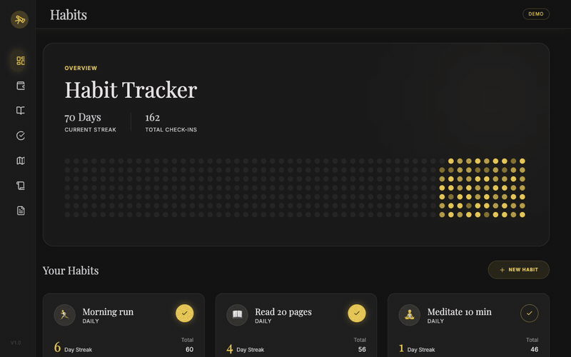
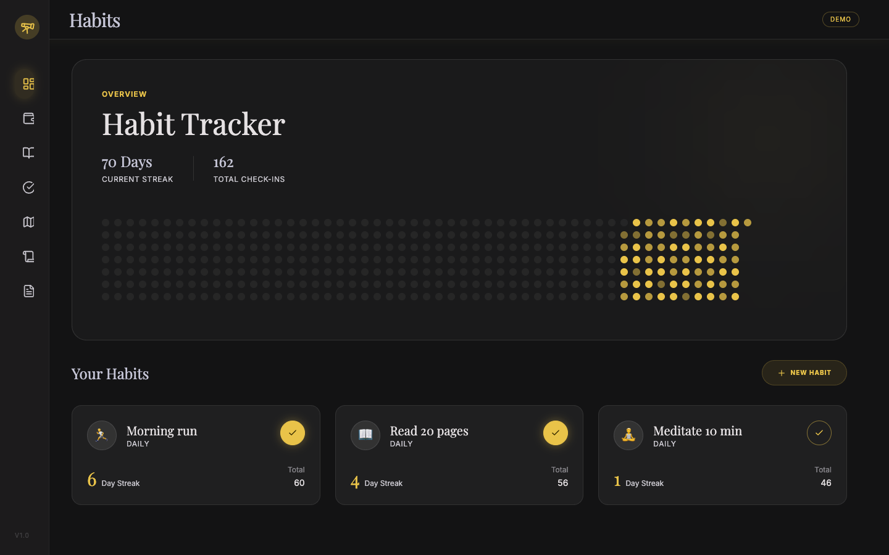
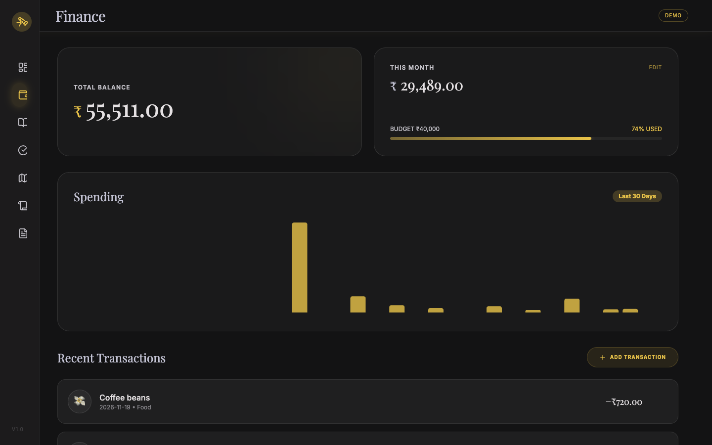
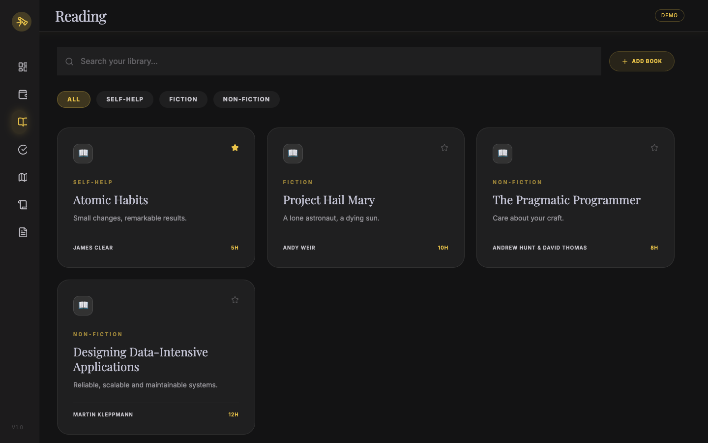
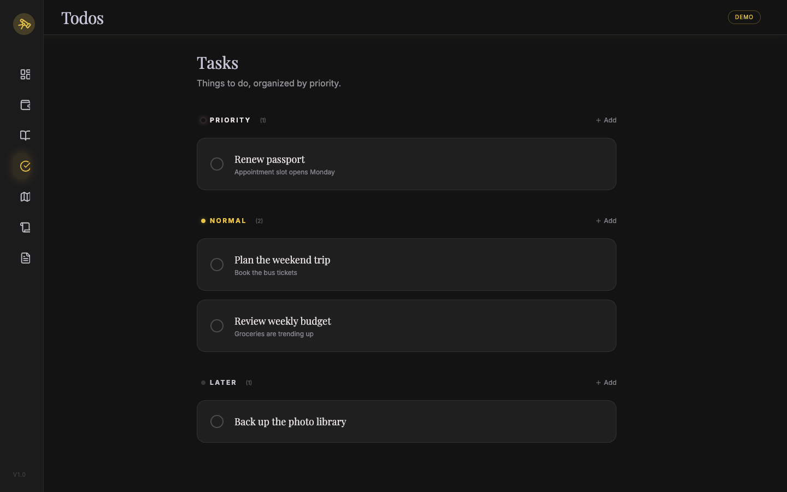
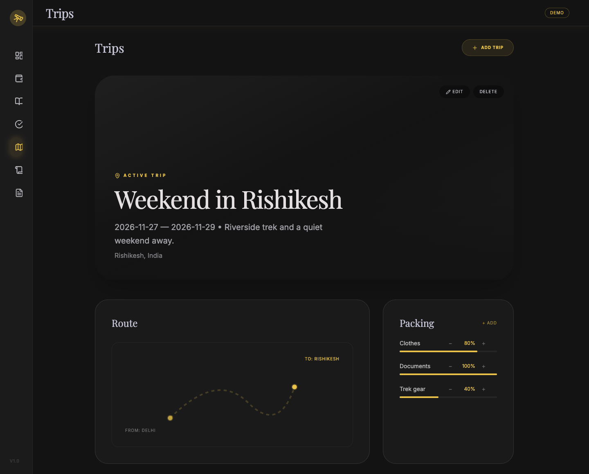
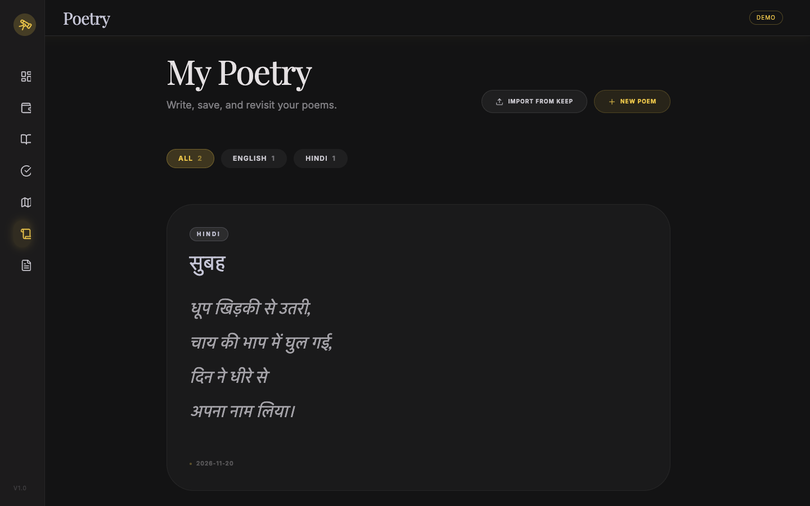
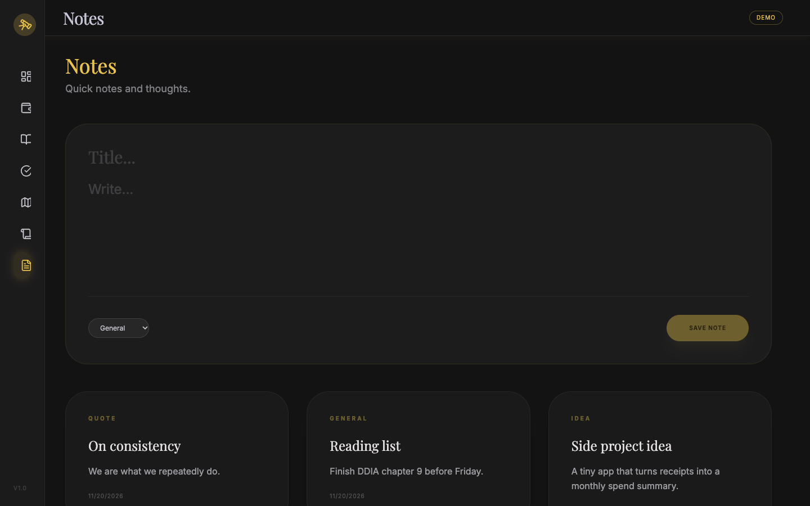
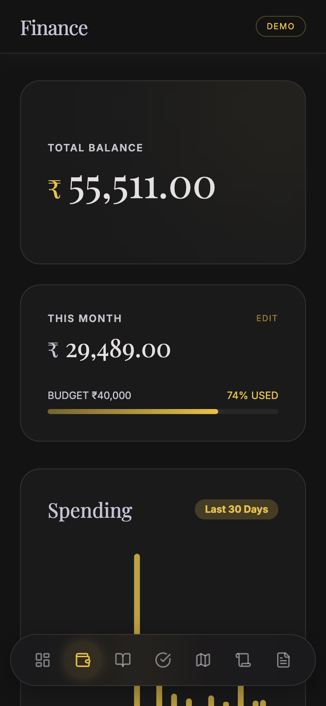
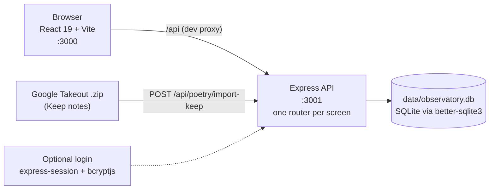

<div align="center">

# Daybook

**Habits, money, reading, tasks, notes, poems and trips in one dashboard that runs on your own machine.**

A self-hosted daily dashboard with a dark glass look and gold accents. Seven screens share one Express API and one
SQLite file that you own: no account, no subscription, no cloud database.



<sub>A real recording of Daybook running locally in demo mode, filled with fictional sample data.</sub>

**[Run it locally](#run-it-locally)** ·
**[The seven screens](#the-seven-screens)** ·
**[How it works](#how-it-works)** ·
**[Configuration](#configuration)**


[](LICENSE)

</div>

---

<details>
<summary><b>Contents</b></summary>

- [Run it locally](#run-it-locally)
- [What you get](#what-you-get)
- [The seven screens](#the-seven-screens)
- [How it works](#how-it-works)
- [Configuration](#configuration)
- [Project structure](#project-structure)
- [Limitations](#limitations)
- [License](#license)

</details>

## Run it locally

Needs Node.js and npm.

```bash
git clone https://github.com/abhiishek-sharma/daybook.git && cd daybook
npm install
npm run dev
```

Open <http://localhost:3000>. It starts in **demo mode**: no login, straight to the dashboard, and an empty database at
`data/observatory.db` that is created on first run (git-ignored).

`npm run dev` starts two processes: the Vite dev server on port 3000, which proxies `/api` to the Express API on
port 3001. If port 3000 is taken, the frontend stops with an error instead of switching ports; free the port, or run
`npx vite --port=3005 --strictPort` next to `npm run dev:server`.

## What you get

- **Seven screens, one place:** habits, finance, reading, todos, notes, poetry and trips, with a sidebar on desktop
  and a bottom bar on a phone.
- **Your data in one file.** Everything is stored in a local SQLite database (`data/observatory.db`, WAL mode). Back it
  up by copying the file.
- **Optional login.** Off by default for demos; `REQUIRE_LOGIN=true` turns on a single-user session login
  (express-session + bcryptjs). No external auth provider.
- **Bring your poems from Google Keep.** Upload a Google Takeout `.zip` and Daybook imports the notes as poems,
  detecting Hindi (Devanagari) or English for each one.
- **Add it to a home screen.** A web app manifest and icons are included.

## The seven screens

<table>
<tr>
<td width="50%"></td>
<td width="50%"></td>
</tr>
<tr>
<td><b>Habits.</b> Daily check-ins with a per-habit streak, an overall streak and a heatmap of the last 365 days.</td>
<td><b>Finance.</b> Running balance, this month's spend against a budget you set, a 30-day spending chart, the change against last month and an income/expense log in ₹.</td>
</tr>
<tr>
<td></td>
<td></td>
</tr>
<tr>
<td><b>Reading.</b> A book library with genre filters, search, a time estimate and a short note per book; starred books come first.</td>
<td><b>Todos.</b> Tasks in three sections (Priority, Normal, Later), each with an optional second line.</td>
</tr>
<tr>
<td></td>
<td></td>
</tr>
<tr>
<td><b>Trips.</b> A pinned active trip with its route and packing progress per category, plus a list of other trips.</td>
<td><b>Poetry.</b> Write and keep poems, feature one, filter by language, or import them from Google Keep.</td>
</tr>
<tr>
<td></td>
<td align="center"></td>
</tr>
<tr>
<td><b>Notes.</b> Quick capture with a category: General, Idea, Reference, Journal or Quote.</td>
<td><b>On a phone.</b> The sidebar becomes a bottom bar.</td>
</tr>
</table>

<sub>All screenshots are of the real app in demo mode with fictional sample data.</sub>

## How it works



- The frontend is a React 19 + TypeScript single-page app (React Router, Tailwind CSS v4, Motion for animation,
  Recharts for the finance chart, lucide icons).
- The backend is Express run with `tsx`. Each screen has its own router under `server/routes/`, and every router sits
  behind the same `requireAuth` middleware, which lets everything through in demo mode.
- `server/db.ts` creates the tables on start-up and runs small in-place migrations, so a new checkout needs no setup
  step.
- Streaks, the heatmap and the finance summary are computed on the server from the stored check-ins and transactions,
  using local dates.

<details>
<summary><b>API routes</b></summary>

| Router | Routes |
|---|---|
| `/api/habits` | `GET /`, `POST /`, `PATCH /:id`, `DELETE /:id`, `POST /:id/toggle`, `GET /heatmap` |
| `/api/finance` | `GET /transactions`, `POST /transactions`, `PATCH /transactions/:id`, `DELETE /transactions/:id`, `GET /summary`, `PUT /budget` |
| `/api/reading` | `GET /`, `POST /`, `PATCH /:id`, `DELETE /:id` |
| `/api/todos` | `GET /`, `POST /`, `PATCH /:id`, `DELETE /:id` |
| `/api/notes` | `GET /`, `POST /`, `PATCH /:id`, `DELETE /:id` |
| `/api/trips` | `GET /`, `POST /`, `PATCH /:id`, `DELETE /:id`, `POST /:id/prep`, `PATCH /prep/:prepId`, `DELETE /prep/:prepId` |
| `/api/poetry` | `GET /`, `POST /`, `PATCH /:id`, `DELETE /:id`, `POST /import-keep` (Takeout zip), `POST /import` (plain text, poems separated by `---`) |
| `/api/auth` | `GET /me`, `POST /login`, `POST /logout` |
| `/api/health` | `GET` |

</details>

## Configuration

It runs with no configuration in demo mode. To require signing in, copy `.env.example` to `.env.local` and set
`REQUIRE_LOGIN=true`. The values in `.env.example` are placeholders: change `OBSERVATORY_PASSWORD` and
`SESSION_SECRET` before you rely on the login. The server only warns when those variables are unset (it then falls back
to `admin` / `changeme` and a built-in secret); it can't tell that you copied the placeholders unchanged.

| Variable | Purpose | Default |
|---|---|---|
| `REQUIRE_LOGIN` | Require signing in | `false` (demo mode) |
| `OBSERVATORY_USER` | Login username | `admin` |
| `OBSERVATORY_PASSWORD` | Login password | `changeme` |
| `SESSION_SECRET` | Signs the session cookie; use a long random string | dev-only value |
| `PORT` | API port | `3001` |

## Project structure

<details>
<summary><b>Folders</b></summary>

```
src/
  screens/     one file per route: Habits, Finance, Reading, Todos, Notes, Poetry, Trips (+ Auth)
  components/  Layout, Navigation (sidebar + bottom bar)
  api/         typed fetch client
  auth/        AuthContext
  hooks/       useResource, the data-fetching hook

server/
  routes/      Express routers, one per screen
  db.ts        schema set-up and migrations
  auth.ts      optional session login
  keep.ts      Google Keep (Takeout) note parser
  index.ts     entry point
public/        icons and the web app manifest
```

</details>

## Limitations

- **Single user.** One login for the whole app; there are no per-user accounts.
- **Development servers only.** `npm run dev` is the way to run it. `npm run build` builds the frontend, but the
  Express server doesn't serve the built files, and the session cookie isn't marked `secure`, so don't expose it to
  the internet as it is.
- **No automated tests** yet.
- **No export button.** Your data is the SQLite file; copy it to back it up.
- The web fonts (Playfair Display and Inter) load from Google Fonts; everything else is local.
- The database file is still named `observatory.db`, from the project's earlier name.

## License

MIT. See [LICENSE](LICENSE).
