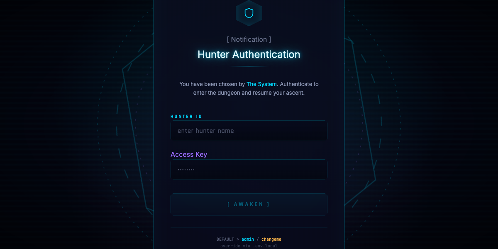
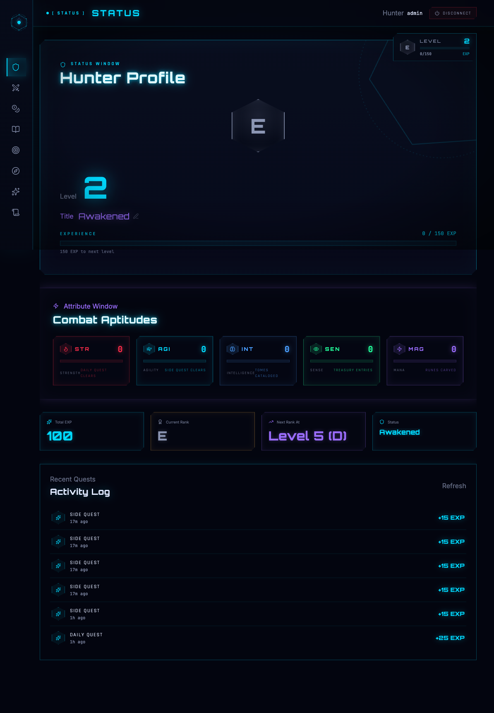

# Personal Dashboard

A self-hosted personal productivity dashboard — dark glass aesthetic, gold accents, runs entirely on your machine. No cloud, no subscriptions.

Built with React + TypeScript on the frontend, Express + SQLite on the backend. Everything persists to a local SQLite file you own.

---

## Screenshots

| Auth | Habits | Finance | Stats |
|---|---|---|---|
|  |  |  |  |

---

## Features

**Habits** — daily check-in tracker with streak counter and contribution heatmap

**Finance** — running balance, monthly spend ceiling, bar chart history, income/expense log

**Reading** — book library with genre tags, star rating, search, and status tracking

**Todos** — tasks with an optional subtext line, grouped by section, toggle/delete

**Notes** — capture notes with categories: General, Idea, Reference, Journal, Quote

**Poetry** — write and store poems

**Trips** — travel log with an "active trip" pin

**Auth** — session-based login with bcrypt, runs locally, no external auth provider

---

## Stack

| Layer | Tech |
|---|---|
| Frontend | React 19, TypeScript, Vite, Tailwind CSS v4 |
| Backend | Express, TypeScript, tsx |
| Database | SQLite via better-sqlite3 |
| Auth | express-session + bcryptjs |
| Animation | Motion (Framer Motion) |
| Charts | Recharts |

---

## Run locally

```bash
# 1. Install dependencies
npm install

# 2. Start both API server and Vite dev server
npm run dev
```

Frontend: `http://localhost:3000`  
API: same port (proxied by Vite)

No environment variables required. The SQLite database is created automatically on first run.

---

## Project structure

```
src/
  screens/     # one file per route: Habits, Finance, Reading, Todos, Notes, Poetry, Trips
  components/  # Layout, Navigation (sidebar + bottom nav)
  api/         # typed fetch client
  auth/        # AuthContext
  hooks/       # useResource — data fetching hook

server/
  routes/      # Express routers matching each screen
  db.ts        # schema setup and migrations
  auth.ts      # session middleware
  index.ts     # entrypoint
```

---

## License

MIT
